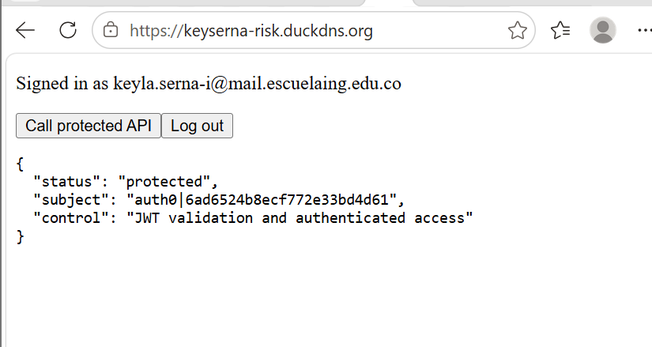
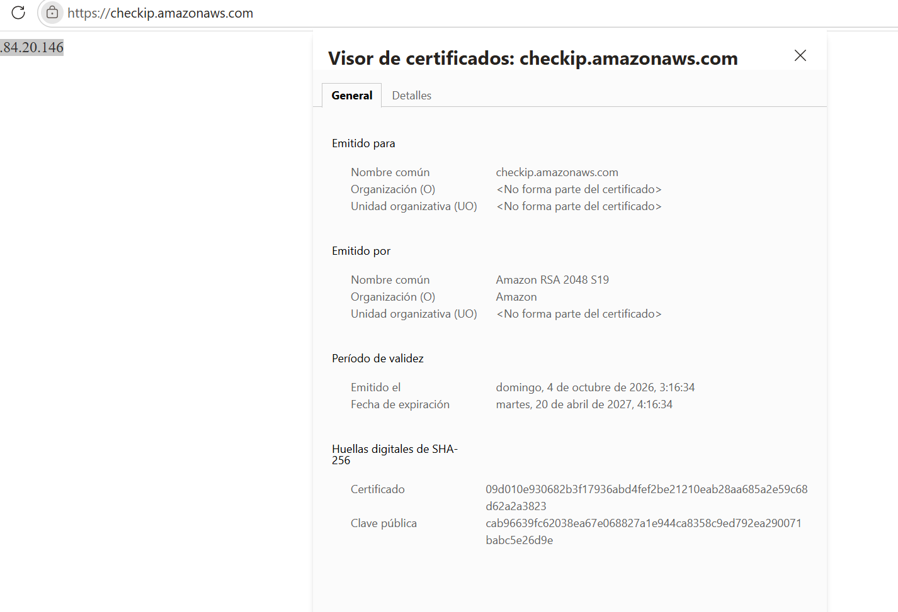

# Enterprise Risk Lab — Secure Web System as an Enterprise Risk Control

**URL desplegada (HTTPS):** https://keyserna-risk.duckdns.org

Sistema web pequeño que aplica controles de riesgo empresarial: un frontend en React autentica al usuario con Auth0, obtiene un access token (JWT) y lo envía en el encabezado `Authorization: Bearer <token>` a una API en Spring Boot protegida como OAuth 2.0 Resource Server. Todo se publica detrás de Apache con un certificado TLS válido de Let's Encrypt.

## Arquitectura

```
Navegador
  │ login y access token
  ▼
Auth0 ───────────────► Frontend React ── Bearer token ──► API Spring Boot (127.0.0.1:8080)
                                                        │
Internet ── Duck DNS ── Apache + TLS (80/443) ──────────┘
```

| Componente | Tecnología |
|---|---|
| Frontend | React + Vite, `@auth0/auth0-react` |
| Identidad | Auth0 (SPA + API con audience `https://enterprise-risk-api`, RS256, permiso `read:risk`) |
| Backend | Java 21, Spring Boot 4.1.1, Spring Security OAuth2 Resource Server |
| Servidor | AWS EC2 (Ubuntu 24.04), Apache 2.4 como proxy inverso, systemd |
| DNS y TLS | Duck DNS (`keyserna-risk.duckdns.org`), Let's Encrypt con Certbot |

## Estructura del repositorio

```
enterprise-risk-lab/
├── backend/          API Spring Boot (endpoint protegido /api/risk-status)
├── frontend/         Cliente React con login de Auth0
├── docs/evidencias/  Capturas de verificación
└── README.md
```

## Ejecución local

**Backend**
```
cd backend
./mvnw spring-boot:run
```
`GET http://localhost:8080/api/risk-status` sin token responde `401 Unauthorized`.

**Frontend**: crear `frontend/.env.local` (no se sube al repositorio):
```
VITE_AUTH0_DOMAIN=<tenant>.us.auth0.com
VITE_AUTH0_CLIENT_ID=<client-id>
VITE_AUTH0_AUDIENCE=https://enterprise-risk-api
VITE_API_URL=http://localhost:8080
```
```
cd frontend
npm install
npm run dev
```

## Despliegue (resumen)

1. Instancia EC2 Ubuntu con security group que solo permite 22 (SSH, restringido a mi IP), 80 y 443. El puerto 8080 no está expuesto.
2. Firewall `ufw` con OpenSSH, 80 y 443; actualizador de Duck DNS por `cron`.
3. Backend como servicio `systemd` (`enterprise-risk-api`) ejecutado por el usuario de sistema `riskapi` (sin login), escuchando solo en `127.0.0.1:8080`.
4. Frontend compilado (`npm run build`) servido por Apache desde `/var/www/enterprise-risk-frontend`; Apache reenvía `/api/` al backend local.
5. Certificado de Let's Encrypt con `certbot --apache` y redirección automática de HTTP a HTTPS.

## Lista de verificación

- [x] Las peticiones sin autenticar a `/api/risk-status` devuelven 401.
- [x] Un usuario autenticado puede llamar a `/api/risk-status` desde el frontend.
- [x] El backend valida el issuer y la audience del JWT.
- [x] La aplicación está disponible en https://keyserna-risk.duckdns.org.
- [x] El navegador muestra un certificado válido y el candado de HTTPS.
- [x] El puerto 8080 no es accesible desde internet.
- [x] `sudo certbot renew --dry-run` termina correctamente.

## Reflexión: controles de riesgo

**Autenticación vs. autorización:** la autenticación responde *quién eres* (Auth0 verifica la identidad del usuario en el login). La autorización responde *qué puedes hacer* (la API solo acepta tokens válidos, emitidos por el issuer correcto y para su propia audience, y Auth0 solo entrega a la SPA el permiso `read:risk` que se le concedió).

| Control | Riesgo que reduce | Evidencia |
|---|---|---|
| Autenticación con Auth0 | Suplantación de identidad y manejo débil de credenciales | [02](docs/evidencias/02-user-delegated-access.png), [08](docs/evidencias/08-llamada-autenticada-https.png) |
| Validación del JWT en la API | Acceso no autorizado a la API | [03](docs/evidencias/03-api-401-sin-token.png), [09](docs/evidencias/09-puerto-8080-cerrado.png) |
| Validación de audience | Reutilización de tokens contra otra API | [01](docs/evidencias/01-api-settings.png) |
| HTTPS con certificado válido | Exposición de credenciales o tokens en tránsito | [06](docs/evidencias/06-certificado-valido.png), [07](docs/evidencias/07-certbot-renew-dry-run.png) |
| Proxy inverso con Apache | Exposición directa del puerto de la aplicación | [05](docs/evidencias/05-security-group.png), [09](docs/evidencias/09-puerto-8080-cerrado.png) |
| Logs centralizados del servicio | Investigación tardía de incidentes | [10](docs/evidencias/10-journalctl-api.png) |

## Evidencias

| # | Evidencia |
|---|---|
| 01 | [API en Auth0: identifier y RS256](docs/evidencias/01-api-settings.png) · [permiso `read:risk`](docs/evidencias/01-api-permissions.png) |
| 02 | [User-Delegated Access de la SPA a la API](docs/evidencias/02-user-delegated-access.png) |
| 03 | [`curl` sin token → 401 (local)](docs/evidencias/03-api-401-sin-token.png) |
| 04 | [Llamada autenticada en local](docs/evidencias/04-llamada-autenticada-local.png) |
| 05 | [Security group: solo 22, 80 y 443](docs/evidencias/05-security-group.png) |
| 06 | [Certificado válido de Let's Encrypt](docs/evidencias/06-certificado-valido.png) |
| 07 | [`certbot renew --dry-run`](docs/evidencias/07-certbot-renew-dry-run.png) |
| 08 | [Llamada autenticada en HTTPS](docs/evidencias/08-llamada-autenticada-https.png) |
| 09 | [8080 cerrado, 443 abierto y 401 en producción](docs/evidencias/09-puerto-8080-cerrado.png) |
| 10 | [`journalctl -u enterprise-risk-api`](docs/evidencias/10-journalctl-api.png) |

**Llamada autenticada en HTTPS**



**Certificado válido**



## Notas de seguridad

- `.env.local`, `.env.production.local`, la llave `.pem` y el token de Duck DNS no se incluyen en el repositorio.
- La SPA usa solo el Client ID de Auth0, nunca un client secret.
- CORS está restringido a `http://localhost:5173` y `https://keyserna-risk.duckdns.org`.
- El access token no se muestra, no se registra en logs ni se guarda manualmente.
- El servicio corre con un usuario de sistema dedicado (mínimo privilegio) y el sistema operativo se actualizó antes de exponerlo.

## Alumna

Keyla Yunuette Serna Illescas — Escuela Colombiana de Ingeniería Julio Garavito
